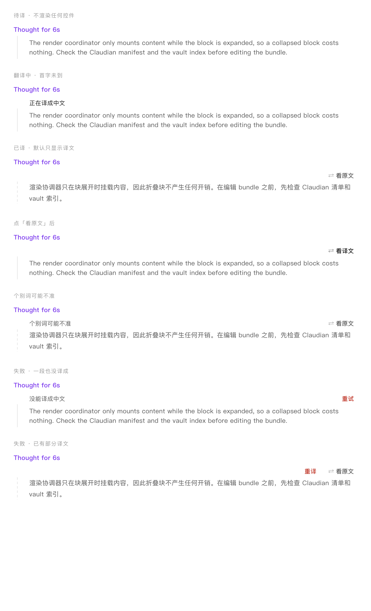

# Claudian Thinking Translator

Translate [Claudian](https://github.com/YishenTu/claudian)'s thinking into Chinese as it streams, only when you expand a block.

- 默认只显示译文，点一下切回原文
- **只在展开思考块时翻译**，折叠状态零请求
- 默认走**免费机翻**（Google），不需要任何密钥
- 以旁挂 DOM 的方式工作：**不改 Claudian 一行代码**



> **Not affiliated with Claudian or Obsidian.**
> This is an independent plugin. It reads the thinking blocks that Claudian renders in the chat view and adds a translation next to them. It contains no Claudian source code and needs Claudian installed to be useful.

## Requirements

- Obsidian desktop (uses Node APIs, so `isDesktopOnly` is set)
- [Claudian](https://github.com/YishenTu/claudian) installed and enabled — this plugin has nothing to translate without it

## Install

```bash
git clone https://github.com/serena-sheng/claudian-thinking-translator
cp main.js manifest.json styles.css \
  "$YOUR_VAULT/.obsidian/plugins/claudian-thinking-translator/"
```

Then enable **Claudian Thinking Translator** in Settings → Community plugins.

`install.sh` syncs the files into a vault for you:

```bash
VAULT="/path/to/vault" ./install.sh
```

## Usage

Expand a thinking block and a single caption row appears:

| Situation | What you see |
|---|---|
| Translating | `正在译成中文`, original still readable |
| Translated | only `⇄ 看原文`; original hidden |
| Content already Chinese | nothing, no request |
| All engines failed | `没能译成中文` + `重试` |

Commands in the command palette:

- `切换思考翻译开关`
- `测试翻译接口`

## Network use

Translation is the only reason this plugin talks to the network. **Nothing is sent while a thinking block stays collapsed.**

| Engine | Endpoint | What is sent |
|---|---|---|
| Google (default, free) | `clients5.google.com`, `translate.googleapis.com` | The text of the thinking block being translated |
| MyMemory (fallback, free) | `api.mymemory.translated.net` | Same, if both Google endpoints fail |
| DeepSeek (optional, paid) | `api.deepseek.com` | Same, plus a short system prompt |

- No telemetry, no analytics, no ads, no self-update.
- Translations are not written to disk; the API key is cached in memory for 30 minutes.
- Turn the feature off entirely with the `启用` toggle, or switch engines in settings.
- If a block contains material you must not send to a third party, collapse it before reading, or disable the plugin.

## Settings

| Setting | Default | Purpose |
|---|---|---|
| 启用 | on | Off = no scanning, no requests |
| 翻译引擎 | 免费机翻 | or DeepSeek (needs a key from 1Password) |
| 最小翻译长度 | 120 | wait for this many characters before cutting a segment |
| 每段目标长度 | 420 | larger = fewer requests, slower first output |
| 静默合并时间 | 1800 ms | flush the tail after this much silence |
| 术语白名单 | `vault skill token …` | keep these words in English |
| 加载时翻译已展开的块 | off | also only translates blocks currently in view |

## Design docs

- Spec and contract: `docs/spec.md`
- Evidence ledger: `docs/evidence.md`
- Changelog: `CHANGELOG.md`

## Known limitations

- Machine translation quality: expect the occasional awkward rendering. Switch to DeepSeek when accuracy matters.
- Depends on Claudian's DOM contract (`.claudian-thinking-block` / `.claudian-thinking-content`). If upstream changes its markup, this plugin silently stops working.
- Desktop only.

## License

MIT
